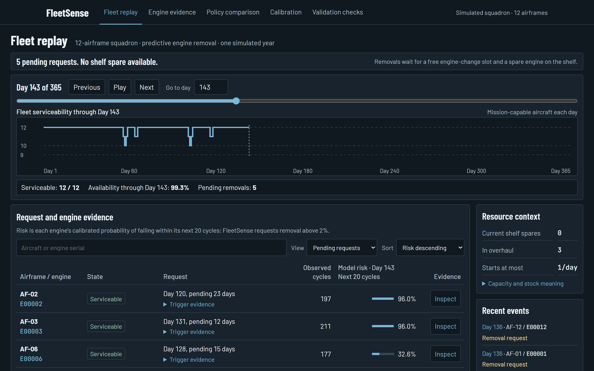
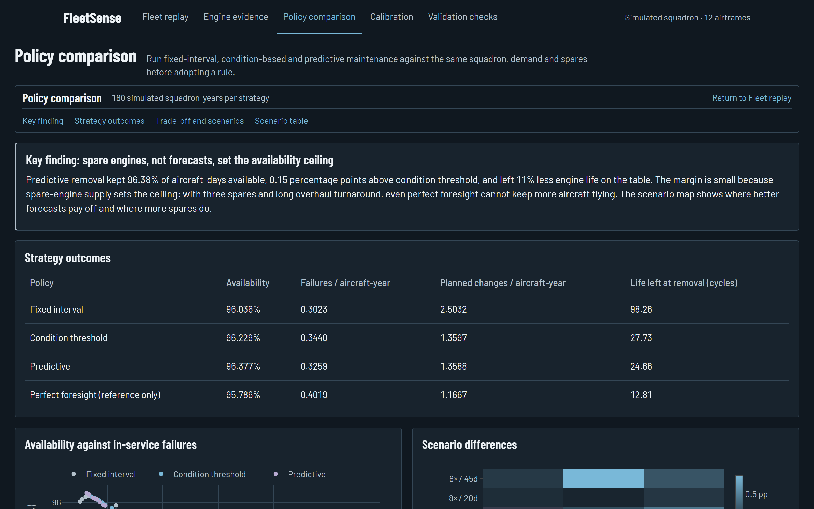

# FleetSense

**Engine-removal planning for a squadron's engineering officer:** which engine should come off the wing next, and will the maintenance plan actually keep aircraft flying?

▶ **[Demo video (2.5 min)](https://youtu.be/koKtFulYVWo)** · 📄 **[Idea deck (PDF)](submission/SIH26249_Idea.pdf)**



## What it does

- **Fleet replay:** a full squadron-year, day by day: airframe status, removal requests, the spares shelf and the overhaul queue.
- **Removal queue:** engines ranked by calibrated risk of failing within the next 20 cycles, with how long each request has waited for a slot and a spare.
- **Engine evidence:** each engine's sensor trend against the fleet band for the same age, its risk at every horizon, and a maintenance history that follows the serial across airframes.
- **Policy lab:** fixed-interval, condition-based and predictive removal run on the same squadron, flying and spares, plus a perfect-foresight reference.
- **Validation checks:** an independent rule checker re-verifies every schedule, and a test proves future data never reaches a decision.



## What we found

On NASA's public C-MAPSS engine data with a simulated 12-aircraft squadron (3 spares, 1 engine change per day):

- **86%** of in-service failures were flagged at least two weeks ahead (609 of 704 across 180 simulated squadron-years).
- Predictive removal wasted **a quarter** of the engine life that fixed-interval removal did.
- Availability landed near **96%** for every policy: with three spares and long overhauls, **spare engines set the ceiling, not the forecast**.
- The independent checker found **0** rule violations and caught **8 of 8** planted bugs. 63 automated tests pass.
- A full year for 200 aircraft simulates in **under a second** on a laptop CPU, fully offline.

## Run it

Requires Python 3.12 on Windows (PowerShell).

```powershell
py -3.12 -m venv .venv
.\.venv\Scripts\python.exe -m pip install -r requirements.lock
.\.venv\Scripts\python.exe -m uvicorn app.server:app --host 127.0.0.1 --port 8601
```

Open http://127.0.0.1:8601. The UI reads the committed results in `results/ui/`, so no data download is needed to explore it. To reproduce everything from scratch (downloads C-MAPSS, retrains, re-simulates), run `scripts\reproduce.ps1`. Tests: `.\.venv\Scripts\python.exe -m pytest -q`.

## Project layout

| Path | Contents |
|---|---|
| `fleetsense/` | features, calibrated forecasts, squadron simulator, planner, independent checker |
| `app/` | FastAPI server and the browser UI (vanilla JS, vendored Plotly, no CDN) |
| `scripts/` | data download, evaluation, UI export, reproduction |
| `results/` | evaluation summary and the data the UI reads |
| `tests/` | unit, integrity and UI tests |
| `docs/STUDY.md` | full study design, evidence and limitations |

## Scope

Engine data is NASA's public turbofan degradation simulation and the squadron is simulated; this is not Air Force data. Risk scores are model evidence, not a physical diagnosis. Next step: one squadron's real engine-health logs and spares pipeline, through read-only adapters to existing maintenance systems.

Built by team **Backpropagators**. MIT licensed.
